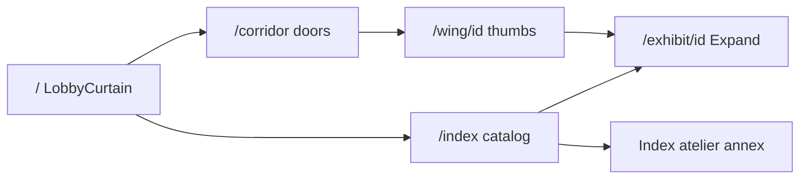
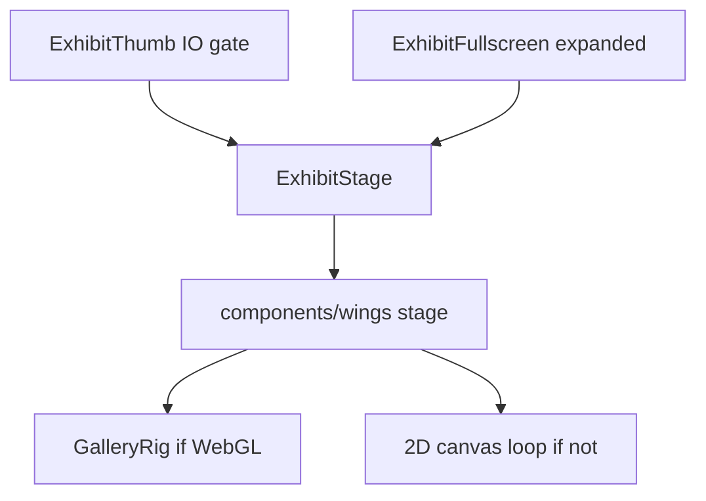

# Architecture

App root: `igris/`. Next.js 16 App Router. Catalog data lives in `lib/museum/`. Every live work mounts through one switch.

## Stack

| Piece | Where |
|-------|--------|
| Next.js 16.4, React 19, TypeScript | `package.json`, `app/` |
| Tailwind 4 | `app/globals.css` (`@import "tailwindcss"`) |
| Three, R3F, Drei, postprocessing | Alcove, Harmonic Sheet, `GalleryRig` |
| Spektral (WebGPU) + Canvas fallback | `components/wings/SpektralPulse.tsx` |
| Pts.js | `components/wings/PtsLocusStage.tsx` |
| Framer Motion | Expand FLIP in `components/museum/ExhibitFullscreen.tsx` |
| Lenis | `components/ui/SmoothScroll.tsx` |
| Fonts | Syne, DM Sans, Geist Mono in `app/layout.tsx` |

Scripts: `dev`, `build`, `start`, `lint`, `atelier` (`python tools/atelier/generate_plates.py`).

## Visitor path

| Route | File | Role |
|-------|------|------|
| `/` | `app/page.tsx` | Shader veil, brand, wing list |
| `/corridor` | `app/corridor/page.tsx` | Six `CorridorDoor`s |
| `/wing/[wing]` | `app/wing/[wing]/page.tsx` | Live thumbs; `relief` redirects to `paradox` |
| `/exhibit/[id]` | `app/exhibit/[id]/page.tsx` | Stage, Expand, placard |
| `/index` | `app/index/page.tsx` | Flat catalog, annex, visitor seeds |
| `/about` | `app/about/page.tsx` | Visit order and Expand copy |
| 404 | `app/not-found.tsx` | Back to corridor |

Nav: `components/ui/Header.tsx` — Corridor, Index, Atelier (`/index#atelier`), About.

## Engine mount path

`components/museum/ExhibitView.tsx` wraps the placard stage in `ExhibitFullscreen` and renders interaction chrome beside it.

`expanded` is a boolean. WebGL stages map it to `GalleryQuality` `"thumb" | "full"`. Canvas stages pass it into `qualityScale`.

## Shared systems

| System | Path | Contract |
|--------|------|----------|
| Gallery lighting | `components/museum/GalleryRig.tsx` | One void, lights, env, contact shadows, bloom. Quality only nudges bloom and presence-cam. |
| Engine switch | `components/museum/ExhibitStage.tsx` | `exhibit.engine` to component. Pass `exhibitId` and `expanded`. |
| Thumb | `components/museum/ExhibitThumb.tsx` | IntersectionObserver; mounts stage only in view; hover hint. |
| Expand | `components/museum/ExhibitFullscreen.tsx` | FLIP from stage rect; portal; Esc; `expanded`. |
| Controls | `components/museum/StageControls.tsx` | `StageControlStrip`, `StageSlider`, `StageToggle`. |
| Pointer | `components/museum/useStagePointer.ts` | Canvas-local pointer for 2D stages. |
| Density | `lib/museum/qualityScale.ts` | `qualityScale(expanded, thumb, full)`. |
| Springs | `lib/museum/spring.ts` | `springStep`, `preferReducedMotion`. |
| Idle motion | `hooks/useIdleLissajous.ts` | Keeps small canvases alive off-pointer. |
| Seeds | `hooks/useSeededParams.ts`, `lib/museum/visitorSeeds.ts`, `lib/museum/exhibitParams.ts` | Defaults first; localStorage in an effect. Key `igris.visitor-seeds.v1`. |
| Hydration gate | `components/museum/ClientMount.tsx` | Children after mount. Wrap every R3F `Canvas`. |
| Lobby | `components/museum/LobbyCurtain.tsx` | Full-bleed shader; `uPointer` from the canvas. |
| Corridor door | `components/museum/CorridorDoor.tsx` | Hero thumb under a gradient; pointer does not hit the vignette. |
| Hints | `lib/museum/interactionHints.ts` | One line per `EngineKind`. |
| Research plaques | `lib/museum/research.ts` | Shown on the exhibit page. |
| Annex viewer | `components/museum/ArchivePlateViewer.tsx`, `ArchiveAnnex.tsx` | Scrub baked frames. |

## Catalog sources

| Data | Path |
|------|------|
| Wings | `lib/museum/wings.ts` |
| Exhibits | `lib/museum/exhibits.ts` |
| Types | `lib/museum/types.ts` (`WingId`, `EngineKind`, `Exhibit`) |
| Annex set ids | `lib/museum/archive.ts` (`ANNEX_SETS`) |

`exhibitsByWing` returns every exhibit tagged with that wing, including annex plates whose `wing` is `forge`. Wing pages filter `engine !== "archive-plates"`. Corridor doors do the same and use the first remaining work as the hero.

## Orphans

These files exist under `components/wings/` and are not imported by `ExhibitStage.tsx`:

- `BrixelLifeStage.tsx`
- `FlipFieldStage.tsx`
- `NeedleChorusStage.tsx`

Do not assume they are on a wall. Wire them into the catalog or delete them. See [CATALOG.md](CATALOG.md).
