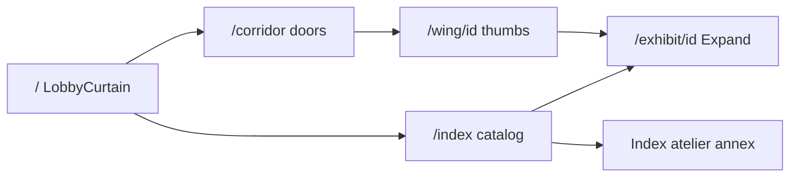
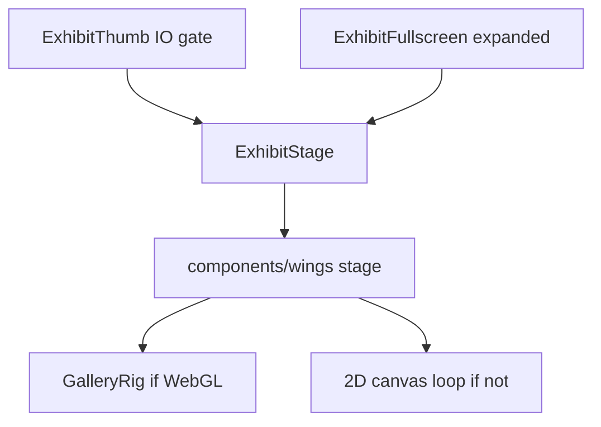

# Igris

A nocturne vault of living sculpture in the browser: six wings of generative engines, a shader lobby curtain, and an offline atelier of baked plates. The shell (routes, tokens, Expand chrome) is ahead of most engines. Many live works still read as basic canvas demos next to the Alcove sculptures.

This file stitches the handoff pack into one brief for the next AI. Read top to bottom.

| Order | Section | Use it for |
|------:|---------|------------|
| 1 | [Handoff](#handoff) | Mission, backlog, definition of done |
| 2 | [Vision and quality bar](#vision-and-quality-bar) | Why the exhibits feel thin |
| 3 | [Fidelity law](#fidelity-law) | Do not break Expand continuity |
| 4 | [Exhibit quality](#exhibit-quality) | Per-engine tier and refinement targets |
| 5 | [Architecture](#architecture) | Routes, mount path, shared systems |
| 6 | [Catalog](#catalog) | Every accession, engine, and component |
| 7 | [Design system](#design-system) | Nocturne tokens and chrome classes |
| 8 | [Atelier](#atelier) | Plate bakery and annex viewers |
| 9 | [Runbook](#runbook) | Install, dev server, verification tour |

## Status snapshot

| Layer | State |
|-------|--------|
| Lobby curtain, corridor doors, wing frames, Expand FLIP, nocturne tokens | Strong |
| Alcove WebGL (ribbon, crystal, knot) + shared `GalleryRig` | Strong |
| Field / Signal / Forge with trails, springs, or control bars | Mid |
| Paradox trio and several Locus diagrams | Basic — primary refinement target |
| Orphan stages not wired into `ExhibitStage` | Dead code — wire or delete |
| Atelier annex cards on Index | Functional; visually off the vault |

Do not redesign the shell while engines are thin. Raise sculptures until they belong in the same room as Blood Ribbon and Shadow Crystal.

---

## Handoff

You are the next owner of Igris. The shell is a nocturne museum. Most engines are still generative sketches inside that museum. Your job is to raise the sketches until they match the room.

Read [Vision](#vision-and-quality-bar) and [Fidelity](#fidelity-law) before editing a stage. Catalog and file paths: [Catalog](#catalog). Per-engine instructions: [Exhibit quality](#exhibit-quality).

### Mission

Make Paradox, then Locus, readable as museum pieces beside Alcove — without a new site, a new wing, or an Expand that changes the sculpture.

### Do not touch first

- `app/page.tsx`, `components/museum/LobbyCurtain.tsx`, corridor layout, header, tokens in `app/globals.css`. The UI is not the complaint.
- `components/museum/GalleryRig.tsx` lighting recipe, unless a change violates [Fidelity](#fidelity-law) and you are reverting it.
- `components/wings/AlcoveRibbon.tsx`, `AlcoveCrystal.tsx`, `AlcoveOrb.tsx`, `HarmonicSheetStage.tsx`, except a regression fix.
- Atelier PNGs, unless you change `tools/atelier/generate_plates.py` on purpose.

### Backlog

| # | Task | Done when |
|---|------|-----------|
| 1 | Endless Cascade | Wet trail, channeled volume, idle flow. Expand only adds drops. See [Exhibit quality](#exhibit-quality). |
| 2 | Closed Tread | Belt has thickness and load compression. Thumb still reads as turning. |
| 3 | Fountain Knot | Ribbon path plus beads. Coil twists the path. |
| 4 | Clifford Vein | Offscreen accumulation. Pointer moves the head; history stays. |
| 5 | Invisible Current | Fading trails; hold bends the field and springs back. |
| 6 | Iron Lattice and Ashfall | Settled layer that is not cleared every frame. |
| 7 | Archive annex chrome | `ArchiveAnnex.tsx` loses `bg-[rgba(232,228,220,0.2)]` and uses the vault frame language. |
| 8 | Orphans | Delete `BrixelLifeStage.tsx`, `FlipFieldStage.tsx`, `NeedleChorusStage.tsx` if still unwired. |

One engine at a time. Run the [Runbook](#runbook) tour after each Paradox piece, including Crystal Expand parity so a shared edit did not restage the glass.

### Definition of done — one refined exhibit

- Wing thumb and exhibit page show the same machine, already moving with the pointer outside the canvas.
- A gesture changes a physical parameter and leaves residue for more than one frame.
- `StageControlStrip` is present and does not block the pointer on the drawing.
- `expanded` changes only counts or DPR (`qualityScale` or an equivalent numeric branch).
- Palette stays void `#0e0e10`, paper `#e8e4dc`, accent `#b91c1c`.
- `npm run build` passes.
- You can screenshot thumb and Expand and still name the work without reading the placard.

### How to add a control without breaking seeds

`useSeededParams(exhibitId, defaults)` must receive a stable default object shape. Do not put `expanded ? a : b` inside the default literal — that hydrates different HTML for the same exhibit. Density belongs in the draw loop, not in the seed.

### Reporting back

When a backlog row is finished, say which file changed, what residue or mass was added, and confirm Crystal closed vs Expand still match if you touched shared museum code.

---

## Vision and quality bar

The museum chrome is acceptable. The works inside it are not. Another AI should treat Igris as a refinement project, not a new website.

### Honest critique

| Surface | What a visitor sees | Gap |
|---------|---------------------|-----|
| Landing | Wavy shader veil, brand-scale type, crimson CTA | Meets the nocturne brief |
| Corridor | Six doors with live vignettes | Vignettes are not playable (`pointer-events-none`); they advertise the wing |
| Wing wall | Live thumbs, accession type, vault frames | Many thumbs are a dark rectangle plus thin strokes |
| Expand | Same engine, denser counts, FLIP from the stage | On Paradox and Locus, denser still looks like the same diagram |
| Alcove | Glass, ribbon, knot under one lighting recipe | The bar the rest of the museum should meet |
| Paradox | Closed loops drawn as strokes on a hard clear | Reads as a sketch, not a machine |
| Locus | Classic generative demos (flow, horizons, packing, tiles) | Textbook algorithms without museum atmosphere |

Adding sliders does not close the gap. Blood Ribbon already has Coil and Glow. Shadow Crystal has Spin and Cast. Paradox already has Flow and Join. The missing layer is mass, light, residue, and idle life.

### Refined vs basic

A work is refined when all of these are true on both the wing thumb and Expand:

1. **Idle life.** It moves before the pointer arrives (Lissajous, breathing, a machine that never stops).
2. **Residue.** Interaction leaves a trace (ink, sand, wake, filings) that outlives the gesture.
3. **Atmosphere.** The void is not a flat `#0e0e10` wipe every frame. Vignette, grain, soft trails, or shared gallery light.
4. **Mass.** Something has weight: springs, inertia, transmission, contact shadow, or a mechanical body.
5. **Expand payoff.** Full window is the same sculpture with more samples, particles, or segments — not a different palette or a bloom that only appears when expanded.
6. **Tactile response.** Hold, drag, or click changes a physical parameter (tension, flow, pole strength), and the piece springs back.

A work is basic when it is a clear-and-stroke loop, a textbook algorithm with a slider, or an Expand that only raises DPR.

### Non-goals

- Purple-on-white, cream-and-terracotta, or broadsheet newspaper layouts.
- Redesigning the header, lobby, or corridor while engines stay thin.
- Expand that swaps materials, environment, or background between thumb and full.
- Menu-first UX. Doors and stages stay the visit; Index stays research mode.
- New wings before existing engines meet the bar above.
- Wiring orphan files (`BrixelLifeStage`, `FlipFieldStage`, `NeedleChorusStage`) unless they replace a basic engine without breaking the catalog.

### Success for the next owner

Open Paradox and Locus next to Alcove. A stranger should not be able to tell which wing was “the demo wing.” Specifically:

- Endless Cascade, Closed Tread, and Fountain Knot read as machines with channels, belts, and returning streams — not polyline toys.
- At least two Locus works (start with Clifford Vein and Invisible Current) have residue and atmosphere at thumb size.
- Crystal closed and Crystal Expand still match ([Fidelity law](#fidelity-law)).
- No new accent colors outside the nocturne tokens in [Design system](#design-system).

---

## Fidelity law

Expand densifies the same sculpture. It does not restage it.

Visitor copy already says this on `/` and `/about`. Code comments in `components/museum/GalleryRig.tsx` and `components/wings/AlcoveRibbon.tsx` repeat it. Treat those as binding.

### Rules

1. **One lighting recipe.** `GalleryRig` uses the same background (`#0e0e10`), ambient, key directional, crimson point, warehouse environment, contact shadows, and bloom for `"thumb"` and `"full"`.
2. **Bloom stays on.** Full may raise bloom intensity slightly (currently `0.3` thumb, `0.36` full). Never toggle the composer off on thumbs.
3. **Materials stay in one family.** Do not change metalness, transmission color, emissive color, or environment preset because `expanded` flipped. Tube radius, emissive intensity, and chromatic amount should match closed and open.
4. **Density is the Expand delta.** Allowed: DPR cap, segment counts, particle caps, transmission `samples` / `resolution`, shadow blur softness. Use `qualityScale(expanded, thumb, full)` in `lib/museum/qualityScale.ts` for numbers.
5. **Presence is motion, not look.** `GalleryPresenceCam` eases the camera on full enter. It must not change lights.
6. **Same component.** Thumb and Expand both render `ExhibitStage` for that engine. Do not mount a different scene when `expanded` is true.

### Hydration

- `useSeededParams` always starts from the defaults argument. Visitor seeds load inside `useEffect`. Do not read `localStorage` in `useState` initializers.
- R3F `Canvas` renders only inside `ClientMount`. A server render of `<Canvas>` mismatches the client.
- Spektral: paint the Canvas fallback first, then upgrade to WebGPU after mount if available. Do not leave a blank stage while the GPU path is pending.

### Checklist before changing a WebGL stage or Expand

- [ ] Thumb and full share `GalleryRig` (or, for canvas works, the same clear/vignette recipe).
- [ ] No `quality === "full"` branch that changes color, emissive base, or environment.
- [ ] `expanded` only changes counts, DPR, samples, or resolution.
- [ ] Slider defaults match between thumb and full (do not bake `expanded` into the initial seed object).
- [ ] Closed Crystal and expanded Crystal still read as the same glass. Use Shadow Crystal (`alcove-crystal`) as the parity check.
- [ ] Reduced motion still settles springs (`preferReducedMotion` in `lib/museum/spring.ts`).

### What went wrong before

Earlier thumbs used a different environment and bloom-off path than Expand. The sculpture changed identity when the visitor pressed Expand. That split was removed. Do not reintroduce a “studio look” that only exists at one quality.

---

## Exhibit quality

Tiers describe the code as it is, not the placard copy. “Strong” means the piece can sit in the vault without looking like a tutorial. Critique belongs here; laws belong in [Fidelity law](#fidelity-law).

### Tiers

| Tier | Meaning |
|------|---------|
| Strong | Material or residue, idle motion, Expand is density, controls change a physical parameter |
| Mid | Real system (springs, chemistry, arm, trail) but still a flat field or thin drawing at thumb size |
| Basic | Clear-and-stroke or textbook diagram; Expand mostly raises counts |

### By engine

| Engine | Tier | Why |
|--------|------|-----|
| `alcove-ribbon` | Strong | Tube, filament, beads, springs, shared rig. Expand = segments. |
| `alcove-crystal` | Strong | Transmission glass, same attenuation family. Expand = samples/resolution. Parity reference. |
| `alcove-orb` | Strong | Knot + shell under the same rig. Spin/Shell do not restage it. |
| `harmonic-sheet` | Strong | Spring mesh, gallery light. Already at the control-bar standard. |
| `sand-pendulum` | Mid | Double pendulum, ember floor, idle drive, Damp/Sand. Still a 2D drawing of a machine. |
| `plotter-arm` | Mid | Two-joint writer with ink memory. Body is schematic. |
| `cam-press` | Mid | Cam, stamp, bloom stamp. Reads as a diagram of a press. |
| `ember-wake` | Mid | Additive wake + idle Lissajous. Atmosphere without a body. |
| `particle-life` | Mid | Species dynamics and controls. Calligraphy, not sculpture. |
| `reaction-diffusion` | Mid | Gray–Scott with F/K. Chemically real, visually a texture. |
| `spektral-pulse` | Mid | Rings; WebGPU path with canvas fallback. Easy to look empty while pending. |
| `endless-cascade` | Basic | Loop positions and drops on a hard clear. |
| `closed-tread` | Basic | Belt ticks and a hub. Little mass. |
| `fountain-knot` | Basic | Bead path. The “knot” is a polyline. |
| `pts-locus` | Basic | Point constellation. |
| `flow-field` | Basic | Filament field. Soft trails help; still a demo. |
| `joy-division` | Basic | Stacked horizons. |
| `circle-pack` | Basic | Growing circles. |
| `tiled-lines` | Basic | Slash grid. |
| `strange-attractor` | Basic | Attractor etch. Best Locus candidate to raise first. |
| `iron-lattice` | Basic | Filings as strokes. Metaphor is good; drawing is thin. |
| `meteor` | Basic | Streaks on a clear. |
| `archive-plates` | Mid | Baked frames are fine. Index cards use a light panel fill that breaks the vault. |

### Priority

Work in this order. Finish one engine to the [definition of done](#definition-of-done--one-refined-exhibit) before starting the next.

1. **Paradox trio** — `EndlessCascadeStage.tsx`, `ClosedTreadStage.tsx`, `FountainKnotStage.tsx`.
2. **Two Locus works** — `StrangeAttractorStage.tsx`, then `FlowFieldStage.tsx`.
3. **Iron and Ashfall** — `IronLatticeStage.tsx`, `MeteorStage.tsx`.
4. **Annex chrome** — `components/museum/ArchiveAnnex.tsx` aligned to `.stage-frame` / nocturne tokens. Do not re-bake plates unless the baker output itself changes.
5. **Orphans** — delete `BrixelLifeStage.tsx`, `FlipFieldStage.tsx`, `NeedleChorusStage.tsx` if they are still unwired after the pass. Do not spend the pass porting them.

Leave Alcove and Harmonic Sheet alone except to fix a fidelity regression.

### Refinement directions

These are constraints on the next edit, not new products. Stay inside the existing component. Do not add a second scene for Expand.

#### Paradox — Endless Cascade

File: `components/wings/EndlessCascadeStage.tsx`.

- Replace the full-frame opaque clear with a dark fade (low alpha rect) so droplets leave a wet trail.
- Draw the channel as a volume: outer wall, inner wall, and a highlight along the impossible climb, not a single stroke.
- Drops should vary size with `params.flow` and cluster at the join biased by `params.join`.
- Idle: keep water moving when the pointer is outside. Hold already raises flow — keep that.
- Expand: raise drop cap via `qualityScale` only. Same palette (`#0e0e10` void, `#b91c1c` accent, `#e8e4dc` paper).

#### Paradox — Closed Tread

File: `components/wings/ClosedTreadStage.tsx`.

- Give the belt thickness, a shadow under the wheel, and tick marks that compress when Load is high.
- Motion blur or a short history of the tread so a thumb-sized canvas still reads as turning.
- Expand: more ticks / higher DPR, same metal and crimson.

#### Paradox — Fountain Knot

File: `components/wings/FountainKnotStage.tsx`.

- Draw the knot as a ribbon with width, not a hairline. Beads are the stream; the path should stay visible when beads are sparse.
- Coil should twist the path, not only offset it.
- Expand: more beads through `qualityScale`.

#### Locus — Clifford Vein

File: `components/wings/StrangeAttractorStage.tsx`.

- Accumulate into an offscreen buffer (same pattern as Sand Pendulum’s floor) so the vein builds instead of redrawing a fresh plot.
- Pointer reshape should disturb the live head; the buffer keeps the past.
- Expand: more iterations per frame, same ash and crimson.

#### Locus — Invisible Current

File: `components/wings/FlowFieldStage.tsx`.

- Longer, fading trails. A few dozen bright heads and a dim history.
- Hold-pull should bend vectors locally and spring back (`springStep`), not teleport the field.
- Expand: more filaments, same ink.

#### Iron Lattice and Ashfall

- Iron: short segments aligned to the pole with a spring, plus a faint settled dust layer that does not clear every frame.
- Meteor: persistent ash on a buffer; new streaks are the event. Click still calls a shower.

#### What not to do while refining

- Do not introduce a new accent (no cyan UI, no purple bloom).
- Do not wrap canvas stages in `GalleryRig` unless you are porting the whole sculpture to meshes. A 2D piece should share the void color and vignette, not fake a 3D studio.
- Do not hide controls on thumbs. The Knot bar (`StageControlStrip`) is the visit standard.
- Do not gate interaction behind Expand. Thumbs on the wing wall must receive pointer events (`ExhibitThumb` does; corridor vignettes intentionally do not).

---

## Architecture

App root: `igris/`. Next.js 16 App Router. Catalog data lives in `lib/museum/`. Every live work mounts through one switch.

### Stack

| Piece | Where |
|-------|--------|
| Next.js 16.4, React 19, TypeScript | `package.json`, `app/` |
| Tailwind 4 | `app/globals.css` (`@import "tailwindcss"`) |
| Three, R3F, Drei, postprocessing | Alcove, Harmonic Sheet, `GalleryRig` |
| Spektral (WebGPU) + Canvas fallback | `components/wings/SpektralPulse.tsx` |
| Pts.js | `components/wings/PtsLocusStage.tsx` |
| Framer Motion | Expand FLIP in `components/museum/ExhibitFullscreen.tsx` |
| Lenis | `components/ui/SmoothScroll.tsx` |
| Fonts | Syne, DM Sans, Geist Mono in `app/layout.tsx` |

Scripts: `dev`, `build`, `start`, `lint`, `atelier` (`python tools/atelier/generate_plates.py`).

### Visitor path



| Route | File | Role |
|-------|------|------|
| `/` | `app/page.tsx` | Shader veil, brand, wing list |
| `/corridor` | `app/corridor/page.tsx` | Six `CorridorDoor`s |
| `/wing/[wing]` | `app/wing/[wing]/page.tsx` | Live thumbs; `relief` redirects to `paradox` |
| `/exhibit/[id]` | `app/exhibit/[id]/page.tsx` | Stage, Expand, placard |
| `/index` | `app/index/page.tsx` | Flat catalog, annex, visitor seeds |
| `/about` | `app/about/page.tsx` | Visit order and Expand copy |
| 404 | `app/not-found.tsx` | Back to corridor |

Nav: `components/ui/Header.tsx` — Corridor, Index, Atelier (`/index#atelier`), About.

### Engine mount path



`components/museum/ExhibitView.tsx` wraps the placard stage in `ExhibitFullscreen` and renders interaction chrome beside it.

`expanded` is a boolean. WebGL stages map it to `GalleryQuality` `"thumb" | "full"`. Canvas stages pass it into `qualityScale`.

### Shared systems

| System | Path | Contract |
|--------|------|----------|
| Gallery lighting | `components/museum/GalleryRig.tsx` | One void, lights, env, contact shadows, bloom. Quality only nudges bloom and presence-cam. |
| Engine switch | `components/museum/ExhibitStage.tsx` | `exhibit.engine` to component. Pass `exhibitId` and `expanded`. |
| Thumb | `components/museum/ExhibitThumb.tsx` | IntersectionObserver; mounts stage only in view; hover hint. |
| Expand | `components/museum/ExhibitFullscreen.tsx` | FLIP from stage rect; portal; Esc; `expanded`. |
| Controls | `components/museum/StageControls.tsx` | `StageControlStrip`, `StageSlider`, `StageToggle`. |
| Pointer | `components/museum/useStagePointer.ts` | Canvas-local pointer for 2D stages. |
| Density | `lib/museum/qualityScale.ts` | `qualityScale(expanded, thumb, full)`. |
| Springs | `lib/museum/spring.ts` | `springStep`, `preferReducedMotion`. |
| Idle motion | `hooks/useIdleLissajous.ts` | Keeps small canvases alive off-pointer. |
| Seeds | `hooks/useSeededParams.ts`, `lib/museum/visitorSeeds.ts`, `lib/museum/exhibitParams.ts` | Defaults first; localStorage in an effect. Key `igris.visitor-seeds.v1`. |
| Hydration gate | `components/museum/ClientMount.tsx` | Children after mount. Wrap every R3F `Canvas`. |
| Lobby | `components/museum/LobbyCurtain.tsx` | Full-bleed shader; `uPointer` from the canvas. |
| Corridor door | `components/museum/CorridorDoor.tsx` | Hero thumb under a gradient; pointer does not hit the vignette. |
| Hints | `lib/museum/interactionHints.ts` | One line per `EngineKind`. |
| Research plaques | `lib/museum/research.ts` | Shown on the exhibit page. |
| Annex viewer | `components/museum/ArchivePlateViewer.tsx`, `ArchiveAnnex.tsx` | Scrub baked frames. |

### Catalog sources

| Data | Path |
|------|------|
| Wings | `lib/museum/wings.ts` |
| Exhibits | `lib/museum/exhibits.ts` |
| Types | `lib/museum/types.ts` (`WingId`, `EngineKind`, `Exhibit`) |
| Annex set ids | `lib/museum/archive.ts` (`ANNEX_SETS`) |

`exhibitsByWing` returns every exhibit tagged with that wing, including annex plates whose `wing` is `forge`. Wing pages filter `engine !== "archive-plates"`. Corridor doors do the same and use the first remaining work as the hero.

### Orphans

These files exist under `components/wings/` and are not imported by `ExhibitStage.tsx`:

- `BrixelLifeStage.tsx`
- `FlipFieldStage.tsx`
- `NeedleChorusStage.tsx`

Do not assume they are on a wall. Wire them into the catalog or delete them. See [Catalog](#catalog).

---

## Catalog

Source of truth: `lib/museum/exhibits.ts` and `lib/museum/wings.ts`. The router is `components/museum/ExhibitStage.tsx`. Interaction one-liners live in `lib/museum/interactionHints.ts`.

Year on every accession is `2026`. Annex plates are tagged `wing: "forge"` so they have a type, but wing grids and corridor doors drop `engine === "archive-plates"`. They appear on `/index` only.

### Wings

| Id | Title | Medium | Hero exhibit (first non-annex) |
|----|-------|--------|--------------------------------|
| `paradox` | Paradox | Closed loops · Canvas | `paradox-cascade` |
| `locus` | Locus | Pts.js · Generative drawing | `locus-constellation` |
| `alcove` | Alcove | WebGL · Three.js | `alcove-ribbon` |
| `field` | Field | Continuous media · Springs | `field-ember` |
| `signal` | Signal | Kinetic · Spektral / Canvas | `signal-swarm` |
| `forge` | Forge | Kinetic sculpture · Canvas | `forge-plotter` |

`/wing/relief` is a static param that redirects to `/wing/paradox`.

### Paradox

| Id | Accession | Title | Engine | Component | Hint |
|----|-----------|-------|--------|-----------|------|
| `paradox-cascade` | IGR.PDX.001 | Endless Cascade | `endless-cascade` | `components/wings/EndlessCascadeStage.tsx` | steer join · hold raises flow · Expand denser |
| `paradox-tread` | IGR.PDX.002 | Closed Tread | `closed-tread` | `components/wings/ClosedTreadStage.tsx` | hold to load · Drive / Load · Expand |
| `paradox-fountain` | IGR.PDX.003 | Fountain Knot | `fountain-knot` | `components/wings/FountainKnotStage.tsx` | move to coil · Beads · Expand denser |

Mediums: closed water loop, self-driving belt, returning stream.

### Locus

| Id | Accession | Title | Engine | Component | Hint |
|----|-----------|-------|--------|-----------|------|
| `locus-constellation` | IGR.LOC.001 | Night Lattice | `pts-locus` | `components/wings/PtsLocusStage.tsx` | drag well · click seed · Expand denser lattice |
| `locus-current` | IGR.LOC.002 | Invisible Current | `flow-field` | `components/wings/FlowFieldStage.tsx` | steer · hold pull · Viscosity on Expand |
| `locus-horizon` | IGR.LOC.003 | Unknown Pleasures | `joy-division` | `components/wings/JoyDivisionStage.tsx` | drag / scroll peaks · Sense on Expand |
| `locus-pack` | IGR.LOC.004 | Colony | `circle-pack` | `components/wings/CirclePackStage.tsx` | hold grow · Auto toggle on Expand |
| `locus-tiles` | IGR.LOC.005 | Ten Thousand Cuts | `tiled-lines` | `components/wings/TiledLinesStage.tsx` | click / drag flip · Expand finer grid |
| `locus-attractor` | IGR.LOC.006 | Clifford Vein | `strange-attractor` | `components/wings/StrangeAttractorStage.tsx` | move reshape · hold deepen · Reset on Expand |

### Alcove

| Id | Accession | Title | Engine | Component | Hint |
|----|-----------|-------|--------|-----------|------|
| `alcove-ribbon` | IGR.ALC.001 | Blood Ribbon | `alcove-ribbon` | `components/wings/AlcoveRibbon.tsx` | drag to orbit · move to coil · hold to tighten · Expand |
| `alcove-crystal` | IGR.ALC.002 | Shadow Crystal | `alcove-crystal` | `components/wings/AlcoveCrystal.tsx` | drag to orbit · glass catches light · Expand |
| `alcove-orb` | IGR.ALC.003 | Monarch Knot | `alcove-orb` | `components/wings/AlcoveOrb.tsx` | drag to orbit · light follows pointer · Expand |

All three sit inside `GalleryRig`. Expand changes DPR and mesh density (ribbon segments, crystal transmission samples), not the material family.

### Field

| Id | Accession | Title | Engine | Component | Hint |
|----|-----------|-------|--------|-----------|------|
| `field-ember` | IGR.FLD.001 | Ember Wake | `ember-wake` | `components/wings/EmberWakeStage.tsx` | trail ember · Linger / Spawn · Expand denser |
| `field-iron` | IGR.FLD.002 | Iron Lattice | `iron-lattice` | `components/wings/IronLatticeStage.tsx` | move pole · hold strengthen · Spring / Pole |
| `field-sheet` | IGR.FLD.003 | Harmonic Sheet | `harmonic-sheet` | `components/wings/HarmonicSheetStage.tsx` | dip sheet · Spring / Ripple · Expand |

Harmonic Sheet is R3F. Ember and Iron are canvas.

### Signal

| Id | Accession | Title | Engine | Component | Hint |
|----|-----------|-------|--------|-----------|------|
| `signal-swarm` | IGR.SIG.001 | Shadow Swarm | `particle-life` | `components/wings/ParticleLifeStage.tsx` | burst · magnet · Friction / Magnet · Expand denser |
| `signal-pulse` | IGR.SIG.002 | Monarch Pulse | `spektral-pulse` | `components/wings/SpektralPulse.tsx` | rings · kick · Speed / Rings · Expand |
| `signal-tissue` | IGR.SIG.003 | Living Tissue | `reaction-diffusion` | `components/wings/ReactionDiffusionStage.tsx` | paint · F / K · Expand |
| `signal-meteor` | IGR.SIG.004 | Ashfall | `meteor` | `components/wings/MeteorStage.tsx` | shower · Ambient / Size · Expand |

### Forge

| Id | Accession | Title | Engine | Component | Hint |
|----|-----------|-------|--------|-----------|------|
| `forge-plotter` | IGR.FRG.001 | Plotter Arm | `plotter-arm` | `components/wings/PlotterArmStage.tsx` | steer · hold ink · Ink / Ambient · double-click clear |
| `forge-cam` | IGR.FRG.002 | Cam Press | `cam-press` | `components/wings/CamPressStage.tsx` | hold rush · move steers stamp · Speed / Ink |
| `forge-pendulum` | IGR.FRG.003 | Sand Pendulum | `sand-pendulum` | `components/wings/SandPendulumStage.tsx` | pluck · click clear · idle drive |

### Atelier annex (Index only)

Viewer: `components/museum/ArchivePlateViewer.tsx` via engine `archive-plates`. Folders under `public/archive/`. Hint for all: scrub frames · Prev / Next · Expand for full window.

| Id | Accession | Title | Folder | Kind |
|----|-----------|-------|--------|------|
| `archive-ember` | IGR.ANN.001 | Ember Register | `reel-ember` | filmstrip |
| `archive-nocturne` | IGR.ANN.002 | Nocturne Cut | `reel-nocturne` | filmstrip |
| `archive-mill` | IGR.ANN.003 | Mill Room | `overlay-mill` | overlay |
| `archive-sprocket` | IGR.ANN.004 | Sprocket Opera | `reel-sprocket-01` | filmstrip |
| `archive-halide` | IGR.ANN.005 | Halide Chamber | `overlay-halide` | overlay |
| `archive-cinder` | IGR.ANN.006 | Cinder Press | `overlay-cinder` | overlay |

Set list constant: `ANNEX_SETS` in `lib/museum/archive.ts`.

### Unwired stage files

Not referenced by `ExhibitStage.tsx`. Not in `exhibits.ts`. Not visitable.

| File | Notes |
|------|--------|
| `components/wings/BrixelLifeStage.tsx` | Grid life; has its own `GalleryRig` usage |
| `components/wings/FlipFieldStage.tsx` | Pointer field; was easy to ship with `pointer-events: none` on thumbs |
| `components/wings/NeedleChorusStage.tsx` | Instanced needles under `GalleryRig` |

Decision recorded for the next AI: do not add a seventh wing to house them. Either delete them or replace a basic canvas engine only after that engine’s refinement plan in [Exhibit quality](#exhibit-quality) is rejected.

---

## Design system

Tokens live in `app/globals.css`. Fonts load in `app/layout.tsx`. Do not invent a second palette for a single exhibit.

### Color

| Token | Value | Use |
|-------|--------|-----|
| `--void` | `#0a0a0c` | Page ground |
| `--void-lift` | `#121218` | Gradient lift |
| `--plaster` | `#16161c` | Secondary dark |
| `--concrete` | `#2a2a30` | Rare mid tone |
| `--beam`, `--ink`, `--paper` | `#e8e4dc` | Type and highlights |
| `--ink-soft` | `rgba(232, 228, 220, 0.62)` | Secondary copy |
| `--steel` | `#a8a49c` | Eyebrows on the veil |
| `--line` | `rgba(232, 228, 220, 0.14)` | Hairlines |
| `--line-strong` | `rgba(232, 228, 220, 0.28)` | Frames |
| `--accent` | `#b91c1c` | CTA, door beam, slider accent |
| `--accent-soft` | `#dc2626` | CTA hover |

Stage void inside WebGL is `#0e0e10` (`GalleryRig` and canvas stages). Keep it. It is the aperture, not the page.

Body background is a fixed red wash plus a paper wash over a void gradient, plus a fixed grain overlay (`body::before`, `mix-blend-mode: overlay`, opacity `0.045`). Reduced motion removes the grain.

### Type

| Role | Family | CSS |
|------|--------|-----|
| Display | Syne 500–800 | `font-[family-name:var(--font-syne)]`, headings in `globals.css` |
| Body | DM Sans | `--font-dm` on `body` |
| Meta | Geist Mono | `.eyebrow`, `.accession` |

`.eyebrow`: uppercase, `letter-spacing: 0.28em`, `0.68rem`.

`.accession`: `0.72rem`, `letter-spacing: 0.08em`.

Do not set Inter, Roboto, Arial, or a system stack on new UI.

### Chrome classes

| Class | Role |
|-------|------|
| `.door` | Corridor and landing thresholds. Hover lifts, crimson edge, breathing dot via `::after`. |
| `.stage-frame` | 16:10 vault aperture, inset shadow. Wing grid and exhibit page. |
| `.stage-host` | Fills the frame; canvas must be `width/height: 100%`. |
| `.placard` | Top rule under exhibit copy. |
| `.sprocket-rail` | Drifting tick row. Reduced motion stops it. |
| `.door-beam` | Opacity pulse on corridor status dots. |
| `.animate-rise`, `.animate-page-in` | Short entrance. Disabled under `prefers-reduced-motion`. |

Controls: `StageControlStrip` is `pointer-events-none` so the stage stays playable; each slider and toggle opts back in with `pointer-events-auto`. Slider accent is `accent-[var(--accent)]`.

### Banned looks

- Purple-on-white or purple-to-indigo gradients.
- Warm cream page (`#F4F1EA`) with terracotta and a high-contrast serif.
- Broadsheet: hairline newspaper columns as the page idea.
- Dark-mode clichés used as decoration: glow stacks, pill clusters, multi-layer shadows, emoji.
- Cards in the hero. `.door` and `.stage-frame` exist because they are the interaction container, not because every block needs a box.
- A second accent. Crimson is the only signal color.

### Shell files

| UI | Path |
|----|------|
| Header | `components/ui/Header.tsx` |
| Footer | `components/ui/Footer.tsx` |
| Landing | `app/page.tsx` |
| Curtain shader | `components/museum/LobbyCurtain.tsx` |
| About | `app/about/page.tsx` |

---

## Atelier

Offline plates. They are not live engines. Visitors scrub frames. The baker does not run in the browser.

### Commands

From `igris/`:

```bash
python -m pip install -r tools/atelier/requirements.txt
python tools/atelier/generate_plates.py
```

npm alias: `npm run atelier` (same script). Dependencies in `tools/atelier/requirements.txt`: Pillow, NumPy.

### Baker

`tools/atelier/generate_plates.py`

- Output root: `public/archive/`
- Frame size: 960×720
- Writes `public/archive/<set>/frame-*.png`, a per-set `manifest.json`, and `public/archive/manifest.json`
- Seeded RNG. Film grain via `film_grain`. Comic cells via `comic_panel` moods `day`, `night`, `ember`.

Sets written:

| Folder | Kind |
|--------|------|
| `reel-sprocket-01` | filmstrip |
| `reel-nocturne` | filmstrip |
| `reel-ember` | filmstrip |
| `overlay-mill` | layers |
| `overlay-halide` | layers |
| `overlay-cinder` | layers |

### Runtime

| Piece | Path |
|-------|------|
| Set list | `ANNEX_SETS` in `lib/museum/archive.ts` |
| URL helpers | `archiveFolderUrl`, `archiveFrameUrl` |
| Types | `ArchiveSetManifest`, `ArchiveRootManifest` |
| Stage | `ArchivePlateStage` in `components/museum/ArchivePlateViewer.tsx` |
| Index grid | `components/museum/ArchiveAnnex.tsx` (`id="atelier"`) |
| Catalog rows | `archive-*` in `lib/museum/exhibits.ts` (`engine: "archive-plates"`, `archive: "<folder>"`) |

Wing pages and corridor doors exclude these rows. Index includes them only inside the annex, not in the flat live catalog (`exhibits.filter(engine !== "archive-plates")` on `app/index/page.tsx`).

### When to re-bake

Re-run the script only if you change the baker (palette, frame count, size, set id). Then commit the new PNGs and manifests together with the script.

Do not re-bake to “fix” the Index card color. That is CSS on `ArchiveAnnex.tsx`: `bg-[rgba(232,228,220,0.2)]`. Align that panel to the nocturne vault; leave the pixels unless the plate art itself is wrong.

If you add a set: create it in the Python script, add the folder to `ANNEX_SETS`, add an exhibit with `engine: "archive-plates"` and `archive` set to the folder, and re-bake.

---

## Runbook

### Install and dev

From `igris/`:

```bash
npm install
python -m pip install -r tools/atelier/requirements.txt
python tools/atelier/generate_plates.py
npm run dev
```

`next dev` binds port 3000. If that port is already this app, the new process exits and tells you the existing PID. Use `http://localhost:3000`. Do not start a second server on 3001 unless you killed the first.

```bash
npm run lint
npm run build
```

`npm run build` is the check before handing the branch off. Plate baking is not part of `build`; missing `public/archive/` makes annex pages empty, not a compile failure.

### Open these first

| Question | File |
|----------|------|
| Where does an engine mount? | `components/museum/ExhibitStage.tsx` |
| What is on the wall? | `lib/museum/exhibits.ts` |
| Lighting / Expand look | `components/museum/GalleryRig.tsx` |
| Thumb vs full numbers | `lib/museum/qualityScale.ts` |
| Why hydration broke | `hooks/useSeededParams.ts`, `components/museum/ClientMount.tsx` |
| What to refine | [Exhibit quality](#exhibit-quality) |
| What not to break | [Fidelity law](#fidelity-law) |

### Verification tour

Dev server up. Walk this in order. Screenshot if a step fails.

1. **`/`** — Syne wordmark, wavy curtain (not a flat black hero), crimson “Enter the corridor”. Move the pointer: the veil should warp toward it (`LobbyCurtain` uniform `uPointer`).
2. **`/corridor`** — Six doors. Paradox, Locus, and Alcove show a living vignette behind the type. Doors link to `/wing/<id>`.
3. **`/wing/paradox`** — Three stages, each with a `StageControlStrip`. Pointer on the canvas changes the machine. Thumbs are not `pointer-events: none`.
4. **`/exhibit/alcove-crystal`** — Glass, Spin, Cast. Expand. The octahedron, crimson bar, and paper bar stay. Esc closes. Full window is denser refraction, not a different studio.
5. **`/exhibit/paradox-cascade`** — Flow and Join visible closed and expanded. This is the baseline the refinement pass must beat; do not treat today’s stroke loop as finished.
6. **`/index#atelier`** — Six plate cards scrub or link. Live catalog above them excludes annex rows.
7. **`/wing/relief`** — Redirects to `/wing/paradox`.

### Reduced motion

OS “reduce motion” disables sprocket drift, page rise, and grain, and springs should snap (`preferReducedMotion`). Do not remove those branches when adding trails.

### Secrets

None. Visitor seeds are `localStorage` only (`igris.visitor-seeds.v1`). Do not add a backend in a refinement pass.
